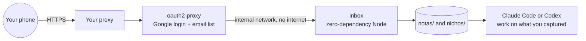

<div align="center">

# 🧪 Niche Lab

**Decide with data whether a YouTube niche is worth it *before* you create the channel — and capture ideas from your phone without opening a terminal.**

[](LICENSE)
[](scripts)
[](inbox/server.mjs)
[](https://keizactech.com/docs)

</div>

---

## ✨ What's inside

| Piece | What it's for |
|---|---|
| 🧮 **`scripts/validar-nicho.mjs`** | Runs a niche through **4 filters** and gives a verdict: **GO**, **ACCEPTABLE** or **DON'T LAUNCH**. It doesn't negotiate. |
| 💡 **`scripts/banco-ideas.mjs`** | Niche candidates and a title-hook generator. No made-up numbers: they're starting points you must validate. |
| 📱 **`inbox/`** | A mobile web inbox: save notes and transcripts, add channels and see the verdict live. |
| 📁 **`plantilla/` + `nuevo-nicho.sh`** | Creates an isolated folder for a new channel, with its own `CLAUDE.md` ready to go. |

> The tool's output and inbox UI are in Spanish — it was built for Spanish-language channels — but the method works for any language.

## 🧮 The 4 filters

A reference channel is a **winner** if:
- it gets **≥ 1,000,000 views a month** (or ≥ 500,000 if its videos run 20 min or longer), and
- its first video is **less than 12 months old**.

| Filter | What it requires |
|---|---|
| 1 + 2 | At least **5 winning channels** |
| 3 | Every reference channel **under 12 months old** |
| 4 | Winners **in English**: that's where you copy the format that already works |
| + | At least **1 competitor in Spanish**, to prove there's demand |

```bash
node scripts/validar-nicho.mjs nichos-ejemplo/ejemplo.json
```
```
VEREDICTO
  NO LANZAR — Faltan 2 canales ganadores. Busca más canales o haz otro doble clic en el tema. NO bajes el umbral.
```
*(DON'T LAUNCH — 2 winning channels missing. Find more channels or drill one level deeper into the topic. DON'T lower the bar.)*

You collect each channel's data yourself, by hand, from **VidIQ** or **Social Blade**. See the format in [`nichos-ejemplo/ejemplo.json`](nichos-ejemplo/ejemplo.json).

## 📱 The inbox



**Secure by design:**
- **There's no terminal behind it.** The server only lists, saves notes, saves channels and computes the verdict. It can't write outside `notas/` and `nichos/`.
- The inbox lives on an **`internal`** Docker network: no published ports and no internet access. Only the login service can talk to it.
- It runs as an unprivileged user with **zero npm dependencies**, so there's no supply chain to watch.

### Run it
```bash
git clone https://github.com/RosaritoRD/laboratorio-nichos.git
cd laboratorio-nichos
cp inbox/oauth.env.example inbox/oauth.env                 # fill in your Google OAuth client
cp inbox/allowed-emails.example.txt inbox/allowed-emails.txt   # who's allowed in
docker compose -f inbox/docker-compose.yml up -d --build
```
In your HTTPS proxy, point `yt.your-domain.com` to `yt-auth:4180`.

## 📁 A new channel in 1 command
```bash
./nuevo-nicho.sh prayers-for-sleep
cd prayers-for-sleep && claude      # or: codex
```
Each niche gets its own folder and `CLAUDE.md`, so the assistant never mixes one channel with another.

## 🤖 With Claude Code or Codex
Save a transcript to the inbox from your phone, then in the terminal: *"Read the latest note in `notas/` and give me 10 titles for niche X"* or *"Validate `nichos/x.json` and tell me which channels are missing."*

## 💸 Savings and tips
See **[SAVINGS-AND-TIPS.md](SAVINGS-AND-TIPS.md)**.

## 🤝 Contributing
Issues and PRs are welcome — look for the [`good first issue`](https://github.com/RosaritoRD/laboratorio-nichos/labels/good%20first%20issue) label and read [CONTRIBUTING.md](CONTRIBUTING.md).

## 📚 More
- Once a niche passes the filters, produce it with **[Oraflow](https://github.com/RosaritoRD/oraflow)**
- 📖 Guides: **[keizactech.com/docs](https://keizactech.com/docs)**

## 📄 License
MIT — see [LICENSE](LICENSE).
