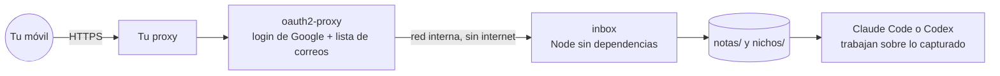

<div align="center">

# 🧪 Laboratorio de nichos

**Decide con datos si un nicho de YouTube vale la pena *antes* de crear el canal, y captura ideas desde el móvil sin abrir una terminal.**

[](LICENSE)
[](scripts)
[](inbox/server.mjs)
[](https://keizactech.com/docs)

</div>

---

## ✨ Qué trae

| Pieza | Para qué |
|---|---|
| 🧮 **`scripts/validar-nicho.mjs`** | Pasa un nicho por **4 filtros** y da un veredicto: **ADELANTE**, **ACEPTABLE** o **NO LANZAR**. No negocia. |
| 💡 **`scripts/banco-ideas.mjs`** | Candidatos de nicho y generador de ganchos de título. Sin cifras inventadas: son puntos de partida que debes validar. |
| 📱 **`inbox/`** | Bandeja web para el móvil: guardar notas y transcripciones, añadir canales y ver el veredicto en vivo. |
| 📁 **`plantilla/` + `nuevo-nicho.sh`** | Crea la carpeta de un canal nuevo, aislada, con su `CLAUDE.md` listo. |

## 🧮 Los 4 filtros

Un canal de referencia es **ganador** si:
- tiene **≥ 1.000.000 vistas al mes** (o ≥ 500.000 si sus vídeos duran 20 min o más), y
- su primer vídeo tiene **menos de 12 meses**.

| Filtro | Qué pide |
|---|---|
| 1 + 2 | Al menos **5 canales ganadores** |
| 3 | Todos los de referencia con **menos de 12 meses** |
| 4 | Ganadores **en inglés**: de ahí se copia el formato que ya funciona |
| + | Al menos **1 competidor en español**, para probar que hay demanda |

```bash
node scripts/validar-nicho.mjs nichos-ejemplo/ejemplo.json
```
```
VEREDICTO
  NO LANZAR — Faltan 2 canales ganadores. Busca más canales o haz otro doble clic en el tema. NO bajes el umbral.
```

Los datos de cada canal los sacas tú, a mano, de **VidIQ** o **Social Blade**. Mira el formato en [`nichos-ejemplo/ejemplo.json`](nichos-ejemplo/ejemplo.json).

## 📱 La bandeja (inbox)



**Seguridad por diseño:**
- **No hay terminal detrás.** El servidor solo lista, guarda notas, guarda canales y calcula el veredicto. No puede escribir fuera de `notas/` y `nichos/`.
- La bandeja vive en una red Docker **`internal`**: sin puertos publicados y sin salida a internet. Solo el login puede hablarle.
- Corre como usuario sin privilegios y con **cero dependencias npm**, así que no hay cadena de suministro que vigilar.

### Levantarla
```bash
git clone https://github.com/RosaritoRD/laboratorio-nichos.git
cd laboratorio-nichos
cp inbox/oauth.env.example inbox/oauth.env                 # rellena tu cliente OAuth de Google
cp inbox/allowed-emails.example.txt inbox/allowed-emails.txt   # quién puede entrar
docker compose -f inbox/docker-compose.yml up -d --build
```
En tu proxy HTTPS apunta `yt.tu-dominio.com` a `yt-auth:4180`.

## 📁 Un canal nuevo en 1 comando
```bash
./nuevo-nicho.sh oraciones-para-dormir
cd oraciones-para-dormir && claude      # o: codex
```
Cada nicho tiene su carpeta y su `CLAUDE.md`, así el asistente no mezcla un canal con otro.

## 🤖 Con Claude Code o Codex
Guarda desde el móvil una transcripción en la bandeja y luego, en la terminal: *"Lee la última nota de `notas/` y sácame 10 títulos para el nicho X"* o *"Valida `nichos/x.json` y dime qué canales faltan"*.

## 💸 Ahorro y mejoras
Ver **[AHORRO-Y-MEJORAS.md](AHORRO-Y-MEJORAS.md)**.

## 📚 Más
- Cuando el nicho pase los filtros, prodúcelo con **[Oraflow](https://github.com/RosaritoRD/oraflow)**
- 📖 Guías: **[keizactech.com/docs](https://keizactech.com/docs)**

## 📄 Licencia
MIT — ver [LICENSE](LICENSE).
